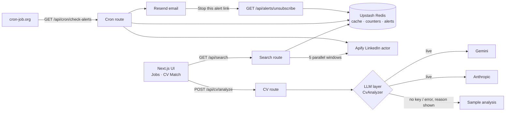

# Job Alert

Next.js app that searches recent LinkedIn jobs, emails you when new ones match a saved search, and scores a CV against a job with an LLM. It runs on free tiers, has daily usage caps, does not store CVs, and falls back to a sample analysis when no LLM key is set.

## Features

- **Job search** across up to 3 countries (EU + UK, Turkey, Dubai) for the last 24 h, week or 2 weeks. English postings only.
- **Posted-time buckets** for the 24 h range: jobs are labelled under 1 h / 3 h / 6 h / 12 h / 24 h, freshest first. Older ranges show "Today", "Yesterday" or "N days ago".
- **Email alerts** checked by cron, de-duplicated per alert, with a "Stop this alert" link in each email.
- **CV match**: upload a PDF (up to 5 MB) or paste text, then pick a job from the results or paste one. Returns a score, an ATS checklist (pass / warn / fail), matched and missing keywords, strengths, gaps and before/after bullet suggestions.
- **English job links**: Apply links in cards and emails are normalised to `https://www.linkedin.com/jobs/view/<id>/?_l=en`.
- **Limits**: per-IP and global daily caps, a 10-minute search cache and a monthly Apify budget guard.

## Architecture



## Tech choices and trade-offs

- **Apify for LinkedIn jobs.** LinkedIn has no public jobs API. A hosted scraper actor avoids running scrapers and proxies; the cost is per-run pricing and no exact posting time. The 24 h view works around that by running five time windows in parallel and labelling each job with the smallest window it appears in.
- **LLM layer.** Routes depend on a `CvAnalyzer` interface; Gemini and Anthropic are interchangeable, chosen by env. A static sample analysis is the fallback for a missing key, quota or outage, and the UI says so: the UI shows "Live analysis" vs "Sample result" and, for a sample, a short reason (`missing_key`, `invalid_key`, `model_not_found`, `rate_limited`, `bad_response`, `upstream_error`). The upstream status and message are logged server-side only.
- **Structured output validated with zod.** Providers are forced to return JSON matching a schema (Gemini response schema, Claude forced tool use), and the result is validated again with zod. Anything invalid falls back to the sample rather than rendering garbage.
- **No invented content.** The system prompt forbids making up employers, titles, dates, skills or achievements. Requirements the CV lacks are listed as gaps.
- **Rate limiting and cost control.** Redis counters with daily expiry cap searches and live CV analyses per IP and globally; cached searches are free and never count. A monthly budget counter stops live Apify runs at a set spend. Without Redis the limits are skipped, so local dev needs no setup.
- **No CV storage.** CVs are processed in memory for the request and sent to the LLM provider; nothing is written to Redis or disk.

## Run locally

```bash
npm install
cp .env.example .env.local   # fill in what you have
npm run dev                  # http://localhost:3000
npm test                     # unit tests (no network, providers are mocked)
```

Without any keys the CV page runs on the sample analysis. Search needs `APIFY_TOKEN`; alerts need Upstash and Resend.

## Environment variables

| Variable | Required | Purpose |
| --- | --- | --- |
| `APIFY_TOKEN` | for search / cron | Apify API token |
| `UPSTASH_REDIS_REST_URL`, `UPSTASH_REDIS_REST_TOKEN` | for alerts, cache, limits | Upstash Redis |
| `RESEND_API_KEY`, `ALERT_FROM_EMAIL` | for alert emails | Resend |
| `CRON_SECRET` | for cron | Secret for `/api/cron/check-alerts` |
| `NEXT_PUBLIC_APP_URL` | recommended | Public base URL for alert email links; falls back to `VERCEL_URL`, then the request origin |
| `LLM_PROVIDER` | no | `gemini`, `anthropic` or `sample` |
| `GEMINI_API_KEY`, `GEMINI_MODEL` | no | Gemini key; model defaults to `gemini-3.1-flash-lite` |
| `ANTHROPIC_API_KEY` | no | Claude (`claude-sonnet-5-5`) |
| `DEMO_*`, `APIFY_MONTHLY_BUDGET_USD`, `APIFY_COST_PER_RESULT_USD` | no | Caps and budget, see below |

## Demo limits

| Variable | Default |
| --- | --- |
| `DEMO_SEARCH_PER_IP` / `DEMO_SEARCH_GLOBAL` | 10 / 40 live searches per day |
| `DEMO_CV_PER_IP` / `DEMO_CV_GLOBAL` | 10 / 40 live analyses per day |
| `DEMO_ALERTS_PER_EMAIL` / `DEMO_ALERTS_GLOBAL` | 3 / 25 alerts |
| `APIFY_MONTHLY_BUDGET_USD` | 4 |
| `APIFY_COST_PER_RESULT_USD` | 0.002 |

When the search cap is hit, cached results of the same query are still served. When the CV cap is hit, the sample result is shown with the reason. The cron route processes at most the global alert cap and does nothing without `APIFY_TOKEN`.

### Apify budget guard

After every live search or cron run, `results * APIFY_COST_PER_RESULT_USD` is added to a monthly Redis counter (`budget:apify:YYYY-MM`). Once it reaches `APIFY_MONTHLY_BUDGET_USD`, live searches stop and show a "monthly demo budget reached" message (cached results are still served) and the cron skips its runs. The counter resets each calendar month. Without Redis the guard is inactive.

## Cron

Call `GET https://<your-app>/api/cron/check-alerts?secret=<CRON_SECRET>` every 1–2 hours from an external scheduler such as cron-job.org. The secret can also be sent as an `x-cron-secret` header. The route only runs between 09:00 and 20:00 Europe/Berlin (add `&force=1` to test) and looks back 3 hours per run.

## Deploy

Deploy on Vercel and set the environment variables above. `/api/search`, `/api/cv/analyze` and `/api/cron/check-alerts` set `maxDuration = 60`, which needs a Vercel plan that allows 60 s functions.

## Privacy

CV text and PDFs are processed in memory and never stored by this app. When a live provider is used, the content is sent to that provider (Google Gemini or Anthropic). Free-tier provider plans may use submitted content to improve their products, so do not submit anything you would not want shared; the sample mode sends nothing anywhere.

## License

MIT
